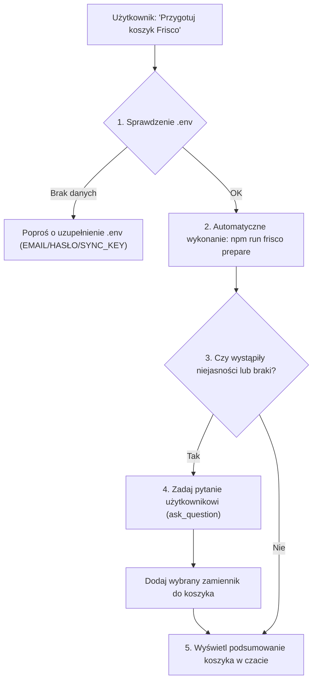

# Frisco Shopper Skill (Autonomous Cart Preparation)

This skill enables the agent to completely automate grocery cart preparation on **frisco.pl** based on the active Foodini meal plan shopping list.

> [!IMPORTANT]
> **Safety Rule**: The agent's responsibility is solely to prepare the cart. Never attempt to finalize checkout, pick paid delivery slots, or enter payment details. Leave the cart open for the user's final review.

---

## Autonomous Workflow (Single Entry Point)

When the user asks to prepare the cart (e.g. _"Przygotuj koszyk Frisco"_, _"Zrób zakupy z Foodini"_):



---

### Krok 1: Weryfikacja konfiguracji `.env`

Sprawdź, czy w pliku `.env` (w katalogu głównym lub `foodini-ui/.env`) zdefiniowano:

- `FOODINI_SYNC_URL`: adres aplikacji Foodini
- `FOODINI_SYNC_KEY`: klucz synchronizacji gospodarstwa
- `FRISCO_EMAIL`: adres e-mail do konta na Frisco.pl
- `FRISCO_PASSWORD`: hasło do konta na Frisco.pl

Jeśli brakuje danych do Frisco, poinstruuj użytkownika, aby uzupełnił je w `.env` lub zapytaj o nie w czacie.

---

### Krok 2: Uruchomienie automatycznego przygotowania koszyka

Wykonaj z poziomu terminala polecenie przygotowania koszyka:

```bash
cd foodini-ui && npm run frisco prepare
```

Skrypt automatycznie:

1. Pobiera aktualną listę niekupionych produktów z Foodini przez API synchronizacji.
2. Uruchamia przeglądarkę Playwright.
3. Loguje się na konto Frisco za pomocą `FRISCO_EMAIL` i `FRISCO_PASSWORD` (jeśli sesja nie jest aktywna).
4. Przelicza gramatury na pełne opakowania (np. potrzebne 500g, opakowanie 400g → 2 sztuki).
5. Dodaje produkty do koszyka.
6. Otwiera stronę `https://www.frisco.pl/koszyk`.

---

### Krok 3: Obsługa niejasności i zamienników (Human-in-the-loop)

Jeżeli w wyniku wykonania skrypt zwróci pozycje niejednoznaczne lub brakujące:

- Użyj narzędzia `ask_question`, aby przedstawić użytkownikowi opcje (np. różne warianty gramatur, marek lub zamienników).
- Po uzyskaniu odpowiedzi dodaj wybraną opcję do koszyka za pomocą:
  ```bash
  cd foodini-ui && npm run frisco -- search "<wybrany produkt>"
  ```

---

### Krok 4: Raport i przekazanie gotowego koszyka

Zwróć użytkownikowi zwięzłe podsumowanie:

- **Liczba dodanych pozycji** oraz łączna wartość koszyka w zł.
- **Lista ewentualnych braków** (produkty niedostępne na Frisco, które trzeba kupić stacjonarnie).
- Poinformuj, że koszyk jest gotowy w otwartej przeglądarce i czeka na zatwierdzenie terminu dostawy oraz płatność.

---

## Baza wiedzy i optymalizacja wydajności

Szczegółowa analiza wydajnościowa, specyfikacja wewnętrznego API Frisco.pl oraz sposoby przyspieszenia procesu dodawania do koszyka (z kilku minut do poniżej 5 sekund) znajdują się w:
👉 [`references/performance-and-api-guide.md`](references/performance-and-api-guide.md)

Kluczowe zasady:

1. **Cache `productId`**: Zawsze utrwalaj sprawdzone `productId` w `resources/mappings.json`, aby przy kolejnych zakupach pomijać czasochłonne wyszukiwanie w UI.
2. **Usuwanie pozycji**: Nadmiarowe produkty usuwaj wyłącznie ze strony koszyka (`https://www.frisco.pl/stn,cart`) za pomocą `button.horizontal-product-box__delete-button`.
3. **Ulotka tygodnia**: Pamiętaj, że Frisco automatycznie dorzuca do każdego koszyka 1 bezpłatną pozycję reklamową (ulotkę o cenie 0,00 zł).
4. **Wewnętrzne API**: W przypadku optymalizacji skryptu preferuj zapytania REST (`/app/commerce/api/v1/`) zamiast pełnych nawigacji `page.goto()`.
